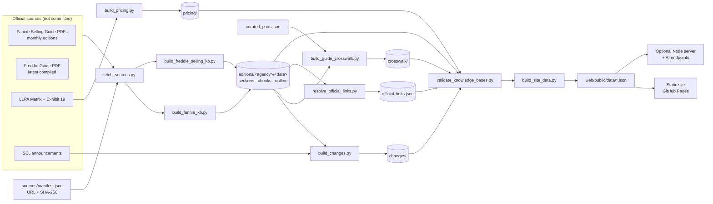

# Technical specification

How the GSE Selling Guide knowledge base is built, how its records are designed, and how Fannie Mae and
Freddie Mac content is linked. Numbers below describe the November 4, 2026 editions unless noted.

**Contents**
1. [Architecture](#1-architecture)
2. [Sources and provenance](#2-sources-and-provenance)
3. [Section extraction](#3-section-extraction)
4. [Chunk design](#4-chunk-design)
5. [Search and retrieval](#5-search-and-retrieval)
6. [Linking Fannie Mae and Freddie Mac](#6-linking-fannie-mae-and-freddie-mac)
7. [Change detection between editions](#7-change-detection-between-editions)
8. [Pricing extraction and comparison](#8-pricing-extraction-and-comparison)
9. [Links to the official guides](#9-links-to-the-official-guides)
10. [Web application and AI layer](#10-web-application-and-ai-layer)
11. [Validation and testing](#11-validation-and-testing)
12. [Known limitations and roadmap](#12-known-limitations-and-roadmap)
13. [Retrieval evaluation](#13-retrieval-evaluation)

---

## 1. Architecture



| Layer | Technology | Notes |
|---|---|---|
| Pipeline | Python 3.11, `pypdf` 7.0 (bookmarks, metadata), `pypdfium2` 5.15 (page text) | Standard library otherwise; no services |
| Storage | JSON / JSONL (committed), SQLite FTS5 (local, rebuilt) | JSONL is the portable layer for any vector DB |
| Web | Vanilla ES modules, no build step or dependencies | `web/public/core.mjs` is shared by the browser and Node |
| Server (optional) | Node 20+ `http` module | Serves the static site plus `/api/ask` and `/api/explain-change` |
| AI (optional) | OpenAI Responses API with strict JSON-schema output | Disabled when `OPENAI_API_KEY` is unset |
| CI/CD | GitHub Actions | Tests and validation, Pages deploy, weekly new-edition probe |

`pipeline/build_all.py` runs the stages in order and only rebuilds what is missing or out of date.

## 2. Sources and provenance

- **`sources/manifest.json`** lists every document: agency, kind (`selling_guide`, `pricing`,
  `eligibility_reference`), edition date, URL, whether the URL is version-pinned, and SHA-256.
- **`fetch_sources.py`** downloads and verifies the PDFs, which stay in a git-ignored `sources/pdfs/`.
  - A hash mismatch on a stable URL (Freddie's guide and Exhibit 19, Fannie's LLPA matrix) signals a new edition.
  - Fannie publishes each guide edition at a dated URL (`selling-guide-november-4-2026`). `--check-latest` therefore
    probes that pattern for every Wednesday since the newest known edition.
- **Archived editions.** Freddie only serves its latest compiled PDF, so earlier Freddie editions cannot be
  re-downloaded. Their extracted `sections.jsonl` is kept in git so change history stays reproducible.
- **Provenance on every record.** Each section and chunk carries `document_id`, `edition_date`, `pdf_page_start`,
  a `citation` string, and a link back to the source.

## 3. Section extraction

The unit of knowledge is the **canonical section**: a Fannie topic such as `B3-3.1-04` or a Freddie section such
as `5302.2`. These are the units the agencies themselves cite, revise, and date.

### 3.1 Locating section boundaries

Both builders use the same strategy:

1. **Read the PDF bookmark tree.** Each bookmark gives a section ID, title, revision date, and an approximate page.
2. **Extract page text** with pdfium and normalize it:
   - NFKC Unicode normalization; dash, soft-hyphen, and non-breaking-space cleanup.
   - Remove repeating page headers from the first 5–6 lines of each page only: Fannie's
     "Published November 4, 2026" plus the page number; Freddie's "Freddie Mac Single-Family Seller/Servicer Guide"
     and "As of MM/DD/YY Page NNNN-N".
3. **Concatenate pages** into one document string, keeping a page-offset table so any character position maps back
   to its PDF page.
4. **Find the visible heading.** Bookmarks are sometimes off by a page, so the builder searches the bookmark page
   and ±2 pages for the heading line (`^B3-3.1-04,` or `^5302.2:`).
5. **Set the section end** at the earlier of the next section heading or the next structural heading
   (Part/Subpart/Chapter for Fannie; Series/Topic/Chapter for Freddie). Chapter introductions therefore never leak
   into the previous section.

Agency-specific rules:

| | Fannie Mae | Freddie Mac |
|---|---|---|
| Section ID pattern | `^[A-E]\d?-\d(\.\d+)?-\d{2},` | `^\d{4}\.\d+:` |
| Extra records | `PREFACE`, `PART-x-INTRO` | `GUIDE-NOTICE` (compilation notice, page 1) |
| Scope | Preface, Parts A–E (cover and table of contents excluded) | "Seller/Servicer Relationship" and "Selling" segments; **Servicing excluded** |
| Scope boundary | — | First page of the `Servicing` bookmark (page 1,966 in July, page 2,103 in November); read from bookmarks, never hardcoded |
| Versions | One version per edition | Current version plus any **future-effective** versions, kept as separate records |
| Edition date | Cover page or PDF title ("Published November 4, 2026") | Page-1 notice ("Current as of Bulletin 2026-15, Published on 11/04/26") |

### 3.2 Versioning (Freddie)

Freddie's compiled PDF can contain both the current text of a section and one or more future versions
("(Future effective date 01/25/27)").

- Each version becomes its own record: `section_record_id = "4301.5::current"` or `"4301.5::future-2027-01-25"`.
- Search, the crosswalk, and pricing use current records by default; future records can be opted into.

**Malformed source bookmarks** are repaired and logged rather than dropped:
- A three-digit year (`11/04/026`) is read as 2026.
- A version dated after the edition date but missing its "Future effective date" label (4702.3 in November 2026)
  is treated as future-effective.

### 3.3 Section record schema (`sections.jsonl`)

```json
{
  "document_id": "fannie-selling-guide-2026-11-04",
  "agency": "Fannie Mae",
  "edition_date": "2026-11-04",
  "section_id": "B3-3.1-04",
  "section_record_id": "B3-3.1-04",
  "section_title": "Verbal Verification of Employment",
  "version_status": "current",
  "revision_date": "2026-10-07",
  "effective_date": null,
  "policy_scope": "selling",
  "hierarchy": {"part": "Part B, …", "subpart": "Subpart B3, …", "chapter": "Chapter B3-3, …", "section": "Section B3-3.1, …"},
  "pdf_page_start": 328, "pdf_page_end": 330,
  "citation": "Fannie Mae Single Family Selling Guide (2026-11-04), B3-3.1-04, PDF p. 328",
  "source_url": "https://singlefamily.fanniemae.com/media/document/pdf/selling-guide-november-4-2026#page=328",
  "official_url": null,
  "text": "B3-3.1-04, Verbal Verification of Employment (10/07/2026) …",
  "text_sha256": "…"
}
```

Field notes:
- `text_sha256` is a hash of the whitespace-normalized text. Change detection uses it as a fast "unchanged" test.
- Freddie hierarchy keys are `segment / series / topic / chapter`. Freddie records also carry `bulletin` and a
  deterministic `official_url`.

## 4. Chunk design

Chunks (`chunks.jsonl`) are the retrieval layer for external RAG and vector databases, and for the local SQLite
full-text index. The web app searches whole sections instead (§5).

### 4.1 Rules

| Parameter | Value | Why |
|---|---|---|
| Primary boundary | **Never cross a section boundary** | A chunk always belongs to exactly one citable section and version |
| Short sections | Kept whole as a single chunk | 54% of Fannie and 59% of Freddie sections fit in one chunk |
| Maximum size | 4,500 characters (about 1,100 tokens) | Fits comfortably in embedding-model limits; long enough to hold one complete requirement with its exceptions |
| Overlap | 500 characters | A rule split across a boundary appears whole in at least one chunk |
| Break point | The **latest** paragraph break, line break, `". "`, or `"; "` that falls between 65% and 100% of the window | Keeps chunks large but ends them on a natural boundary; falls back to a hard cut only when none exists |
| Overlap start | Moved forward to the next whitespace (within 120 characters) | Avoids starting a chunk mid-word |

```text
section text ─────────────────────────────────────────────────────────────▶
chunk 1 [0 ───────────────── 65% ··· break≤4500]
chunk 2                       [break−500 ───────── 65% ··· break]
chunk 3                                             [break−500 ──── end]
```

### 4.2 Chunk record

Each chunk inherits **all** section metadata, so a single chunk is self-describing: agency, edition, IDs, title,
version status and dates, hierarchy, pages, citation, and links. Chunks add:

- `chunk_id = <document_id>::<section_record_id>::<NNN>`, which is stable within an edition.
- `chunk_index`, `chunk_count`, and `char_count`.

### 4.3 Measured sizes (Nov 4, 2026)

| | Sections | Chunks | Median chunk | Longest section | Most chunks in one section |
|---|---|---|---|---|---|
| Fannie Mae | 433 | 779 | 4,033 chars | 47,798 chars | 12 |
| Freddie Mac | 626 (incl. 93 future versions) | 1,216 | 4,287 chars | 65,700 chars | 17 |

**Retention.** Only the latest edition per agency keeps `chunks.jsonl`. Earlier editions keep `sections.jsonl`,
which is all that change detection needs.

**Known limitation.** Continuation chunks (index 2 onward) do not repeat the section heading in their `text`; the
heading is only in metadata. When embedding chunks, prefix each with
`"<agency> <section_id> <section_title> — <hierarchy>"` for better recall. This is on the roadmap.

## 5. Search and retrieval

### 5.1 In the browser and the Node server

Both use `searchSections()` in `core.mjs` over whole sections. For each query term (after removing stop words):

```
term score  = 9 × (hits in "id + title") + 3 × ln(1 + min(10, hits in body))
            + 60 if the term equals the section ID exactly
phrase bonus = +30 if the whole query appears in the title, +12 if it appears in the body
final score  = Σ term scores × (0.4 + 0.6 × (matched_terms / query_terms)²)
```

The squared coverage factor strongly prefers sections that match all of the query's terms.

### 5.2 Ask & compare

`retrieveEvidence()` runs the query against each agency separately:
1. Take the top 20 hits and de-duplicate by section.
2. Keep the top 4 sections per agency as evidence.

Agency terminology is mapped first (§6.2). The Node server always re-runs retrieval itself and never trusts
evidence sent from the browser.

### 5.3 Command line

`pipeline/query.py search` uses the per-edition SQLite FTS5 index (`unicode61`, diacritics removed). It ranks with
`bm25(chunks_fts, 0, 8, 4, 1, 1)`, weighting section ID 8×, title 4×, hierarchy 1×, and text 1×.

## 6. Linking Fannie Mae and Freddie Mac

The guides share no common numbering, so the system links them in four independent ways:

| Link type | Where | How |
|---|---|---|
| Section crosswalk | `crosswalk/` | Lexical and structural matcher, plus human-curated pairs |
| Terminology mapping | Query time (`core.mjs`) | Rewrites agency-specific terms before retrieval |
| Pricing cell alignment | `pricing/` | Normalized keys for transaction, attribute, score band, and LTV band |
| Ask & compare pairing | Runtime | Independent retrieval in each guide for the same question |

### 6.1 Section crosswalk (how the pairs are found)

**Goal.** For each of the 427 Fannie topics, propose the 5 most likely Freddie counterparts among the 532 current
Freddie sections (selling plus shared-relationship scope). That gives 2,135 candidate pairs. The crosswalk is
deterministic and needs no model or API, so results are reproducible and auditable.

**Step 1: normalize vocabulary.**
- NFKC, lowercase, strip ® and ™, split into alphanumeric tokens.
- Remove 50 stop words that are generic in both guides ("loan", "mortgage", "seller", "requirement",
  "general", …).
- **Token aliases** map agency synonyms to one token:
  - `du`, `lpa` → `aus`
  - `homeready`, `homepossible` → `affordable`
  - `homestyle`, `choicerenovation` → `renovation`
  - `cltv`, `tltv` → `totalltv`
  - `eligibility`, `ineligible` → `eligible`
  - plus common plurals
- **Phrase aliases** add shared tokens:
  - "desktop underwriter" and "loan product advisor" → `aus automated underwriting`
  - "limited cash out" and "no cash out" → `noncashout refinance`
  - "high balance" and "super conforming" → `highbalance superconforming`
  - "inter vivos revocable trust" and "living trust" → `livingtrust`
  - "accessory dwelling unit" → `adu`
  - "co op" → `cooperative`
- **23 policy domains**, such as `income_employment`, `assets_reserves`, `condo_coop`, `appraisal_valuation`,
  `refinance`, `ltv`, `loan_delivery`, and `quality_control`. Each section's title and hierarchy are tagged with the
  domains whose trigger phrases they contain.

**Step 2: build two BM25 indexes** over Freddie sections (k1 = 1.5, b = 0.75, idf = ln(1 + (N − df + 0.5)/(df + 0.5))):
- a **title index** over Freddie section titles;
- a **content index** over Freddie section text.

**Step 3: build queries from each Fannie topic.**
- **Title query:** the Fannie title tokens, weighted 2.5.
- **Content query:** the 28 most informative tokens of the Fannie text (ranked by `min(3, tf) × idf`), weight 1
  each. Hierarchy tokens are added at weight `0.7 × min(2, tf)` and title tokens at weight `3 × min(2, tf)`.

**Step 4: generate candidates.** Take the union of the top 40 sections from the title index and the top 40 from
the content index (at most 80 candidates).

**Step 5: score each candidate on six features.**

| Feature | Definition | Weight |
|---|---|---|
| Title relevance | Title-index BM25, divided by the best score for this topic | 0.22 |
| Text relevance | Content-index BM25, divided by the best score for this topic | 0.22 |
| Title coverage | Share of Fannie title tokens that appear in the Freddie title | 0.22 |
| Title Jaccard | Token-set Jaccard of the two titles | 0.14 |
| Title sequence | `difflib` ratio of the sorted title tokens | 0.10 |
| Domain alignment | Jaccard of the two sections' policy-domain sets | 0.10 |

**Step 6: assign confidence** to each topic's ranked top 5:
- **High:** rank 1 *and* score ≥ 0.68 *and* a lead of ≥ 0.08 over rank 2 *and* title coverage ≥ 0.35.
- **Medium:** score ≥ 0.50.
- **Low:** everything else.

Current split of the 427 top matches: **86 high, 261 medium, 80 low.** The low-confidence top matches are written
to `crosswalk/review_queue.jsonl` for human review.

**Step 7: apply human curation.** `crosswalk/curated_pairs.json` holds person-confirmed pairs, each with a
relationship (`counterpart`, `partial`, `no_counterpart`), a status, and the reviewer and date. Curated pairs are
used three ways:
1. Matching candidates are tagged `review_status = "curated_match"`, and the web app lists curated pairs first.
2. They serve as the evaluation set: validation requires at least 80% of curated topics to have a curated pair in
   the machine's top 3 (currently 11/11).
3. A curated pair that references a section ID no longer present (after renumbering) fails validation as
   **stale**, so curation cannot silently rot.

Every crosswalk row is labeled `legal_equivalence: "not_determined"`. A pair means the two sections cover the same
subject, not that their rules are the same.

**Example output (top matches):**

| Fannie topic | Freddie candidate | Score | Confidence |
|---|---|---|---|
| B3-5.2-02 Types of Credit Reports | 5203.1 Credit reports | 0.86 | high (correct) |
| B4-2.1-02 Waiver of Project Review | 5701.11 Condo Project Advisor – Project Waiver Request | 0.62 | medium (correct) |
| B3-4.2-02 Depository Accounts | 5501.8 Automated asset assessment … | 0.53 | medium (likely wrong) |
| A1-1-01 Application and Approval of Seller/Servicer | 2101.5 Organizational changes … | 0.24 | low (wrong) |

The matcher is good at finding the right neighbourhood but weak on topics whose titles use different vocabulary.
That is why curated pairs exist, and why a semantic re-ranker is on the roadmap (§12).

### 6.2 Terminology mapping at query time

Some concepts have different names at each agency. Before retrieval, `queryForAgency()` rewrites the question:
- "limited cash-out", "no cash-out", and "rate and term" become **"limited cash-out refinance"** for Fannie and
  **"no cash-out refinance"** for Freddie.
- Questions about generic cash-out refinance are left alone, so the two are never conflated.

When the question is about limited cash-out, evidence is restricted to sections whose titles carry the
agency-specific phrase. The AI prompt repeats the same rule.

### 6.3 Pricing alignment

Pricing cells are linked by a normalized key, `(pricing_family, transaction, attribute, score_band, ltv_band)`:

- **Transactions:** Fannie "Limited Cash-out Refinance" and Freddie "No Cash-out Refinance" both map to
  `rate_term_refinance`.
- **Attributes:** label patterns are mapped to shared keys, for example "Condo" and "Condominium Unit" →
  `condominium`, "High-balance ARM" and "Super Conforming ARM" → `high_balance_arm`, "Subordinate financing" and
  "Secondary Financing" → `subordinate_financing`.
- **Score bands:** Fannie labels "760 – 779" and "≤ 639" and Freddie labels "≥ 760 & < 780" and "< 640" normalize
  to the same keys (`760_779`, `lt_640`).

See §8.

### 6.4 Ask & compare pairing

A plain-language question is not routed through the crosswalk. Each guide is searched independently with the
agency-adapted query, so a question can surface relevant sections even where the crosswalk is weak. The
evidence-only summary compares the top section from each side; the AI summary receives up to four sections per
agency.

## 7. Change detection between editions

`build_changes.py` compares two editions of one agency's guide. `build_all.py` runs it for every **consecutive**
pair of editions, so Fannie gets month-by-month change logs (June → Aug → Sep → Oct → Nov 2026).

### 7.1 Matching sections across editions

Section IDs are not stable: in August 2026 Fannie retired two condo-review topics and renumbered the remaining
B4-2.2 topics, and Freddie consolidated 2101.7–2101.15 into fewer sections. Sections are therefore matched in a cascade, and each step only considers sections the previous
steps left unmatched:

1. Same ID and same normalized title.
2. Same title under a different ID, if the title is unique: **renumbered**.
3. Same ID with a similar title (`difflib` ratio ≥ 0.6) or similar body (5-word-shingle Jaccard ≥ 0.3).
4. Global greedy match on body similarity (5-word-shingle Jaccard ≥ 0.35).

Comparisons use the body with the heading line (which contains the date) and stray header/footer lines removed.

### 7.2 Classifying each change

| Type | Rule |
|---|---|
| (unchanged) | Text hash equal, same ID, title, and date; not emitted |
| `date_only` | Text equal, revision date differs |
| `retitled` | Text equal, title differs |
| `renumbered` | Matched under a different ID |
| `layout_only` | Word-multiset overlap ≥ 0.985: same words in a different order (PDF table reflow) |
| `editorial` | Text changed but the agency did not re-date the section (usually cross-reference renumbering or navigation links) |
| `revised` | Text changed and the revision date moved |
| `added` | New section with no match |
| `removed` / `merged` / `split` | No match. For each old section, compute what share of its 5-word shingles appears in each new section. Successors are sections holding ≥ 8% of the old text: one successor makes it `merged`, two or more make it `split` |
| `restructured` | An old section disappears and a new one reuses its ID with different content (e.g. Fannie B3-3.8-01 "Rental Income" → "General Rental Income Information") |
| `took_effect` (Freddie) | The new current text equals a future version announced in the old edition |
| `upcoming` / `upcoming_revised` (Freddie) | A future-effective version that is new in this edition, or whose text changed; diffed against the current version |

Only substantive types are shown by default. `layout_only` and `editorial` changes are kept in the data but hidden
unless requested.

### 7.3 What a change record contains

- **Sentence diff.** Text is split into sentences and bullet items and compared with `difflib.SequenceMatcher`.
  Up to 40 added and 40 removed sentences (each ≤ 600 characters) are stored; the website shows 15.
- **Similarity ratio.** An overall measure of how much the text changed.
- **Successors**, with each one's share of the old text (for merges and splits).
- **Announcement link** (Fannie). Two signals:
  1. The section's new revision date equals an announcement date (SEL-2026-07 on Aug 5, -08 on Sep 2, -09 on Oct 7,
     -10 on Nov 4).
  2. The section ID is cited in that announcement's PDF text (`cited_in_announcements`).
- **Links** to the official section page and the PDF page.

## 8. Pricing extraction and comparison

`build_pricing.py` parses every pricing document listed in the manifest. There is no hand-typed grid data.

1. **Identify the grid on each page** from its header:
   - Fannie: "Purchase Money Loans", "Limited Cash-out Refinances", "Cash-out Refinance Loans",
     "Minimum Mortgage Insurance Coverage Option".
   - Freddie: "Section 3/4/5 …", "CUSTOM MORTGAGE INSURANCE OPTIONS".
2. **Parse rows.** A row is a label followed by at least 4 percentages (`ROW_RE`).
   - A label that parses as a credit-score band is a base-grid (or mortgage-insurance) row.
   - Any other label is a loan-attribute row.
   - Footnote digits are stripped from labels ("Condo1", "Secondary Financing 8, 9").
   - A trailing Fannie special feature code (SFC) is captured.
3. **Assign LTV bands by column count:**
   - 9 columns: ≤30, 30–60, 60–70, 70–75, 75–80, 80–85, 85–90, 90–95, >95.
   - 5 columns: cash-out refinance, LTV ≤ 80.
   - 4 columns: mortgage insurance, 80–97.
4. **Flag source quirks** rather than hide them. Fannie's mortgage-insurance grid labels its top band "> 740", which
   would leave a score of 740 in no band; it is read as ≥ 740 and flagged.
5. **Compare** like-for-like cells across the agencies (§6.3), and each agency's latest document against its
   previous version.
6. **Credits and waivers** are short lists, not grids, so they are transcribed in `curated_provisions.json`. Every
   build re-checks that each entry's quoted text still appears in the PDF, so a changed provision fails the build.

Validation requires exactly 207 base-grid cells and 32 mortgage-insurance cells per agency, unique cell IDs, and
matching source hashes.

## 9. Links to the official guides

- **Freddie:** the URL is deterministic: `https://guide.freddiemac.com/app/guide/section/<id>`.
- **Fannie:** the online guide's URL needs a title slug, e.g. `/sel/b3-5.1-01/general-requirements-credit-scores`,
  and the slug rules are not fully predictable. `resolve_official_links.py` generates candidates from the current
  title and from earlier titles for the same ID, with and without stop words, removing periods so "U.S." becomes
  "us". It **fetches each candidate** and keeps only links that return a real page. Currently 397 of 427 resolve.
- **Fallback:** sections without a verified link fall back to the version-pinned official PDF URL with `#page=N`.

## 10. Web application and AI layer

- **Static first.** `build_site_data.py` packs the committed data into compact JSON: about 9 MB raw, roughly
  2.5 MB gzipped. Sections are only fetched when a view needs them. GitHub Pages serves the site with no server.
- **Shared logic.** `web/public/core.mjs` holds search, retrieval, terminology mapping, the evidence-only
  comparison, pricing lookup, and change filtering. The browser and the Node server import the same file.
- **Optional AI.** With `OPENAI_API_KEY` set, the server exposes:
  - `POST /api/ask`, a cross-agency comparison;
  - `POST /api/explain-change`, a plain-English summary of one change record.

  Both use structured output (a strict JSON schema). The prompts:
  - treat the excerpts as untrusted data;
  - forbid claims of legal equivalence and invented page numbers;
  - enforce the terminology rule from §6.2.

  If the key is missing or a call fails, the server returns the deterministic evidence-only result instead.
- **Evidence-only comparison** (no AI). Extracts and compares numeric thresholds ($ amounts, percentages,
  day/month/year periods) and obligation verbs (must, may, may not, required, ineligible, …) between the two
  sections, and reports vocabulary overlap.
- **Security.** Strict Content-Security-Policy, path-traversal guard on static files, 100 KB request limit. The API
  key never reaches the browser. All rendered text is HTML-escaped, and only `https://` links are rendered.

## 11. Validation and testing

| Level | What is checked |
|---|---|
| Builders (`validation.json` per edition) | Every bookmarked section located; every heading matches its ID; no empty sections or chunks; no duplicate record IDs; no Servicing sections; future records carry the future heading; date-repair warnings logged |
| `validate_knowledge_bases.py` (62 checks) | Per-edition integrity; every consecutive edition pair has a change log, and change IDs resolve to real sections in both editions; crosswalk IDs resolve to the latest editions; no stale curated pairs; pricing validation passes; all links are HTTPS |
| Python unit tests (12) | Date repair, chunk limits, score-band and attribute normalization across agencies, renumbering detection, layout-only and editorial classification, sentence diff, slug rules |
| JavaScript tests (11) | Ranking, section-ID lookup, future-version filtering, terminology mapping, limited-cash-out retrieval, pricing sums, AI fallback, change filters, consistency of the built site data |
| CI | All of the above on every push and pull request; the site deploys only from `main` |
| Regression anchor | Re-extracting the June/July 2026 PDFs with this pipeline reproduces the original July knowledge base exactly (432/432 Fannie and 603/603 Freddie sections, identical text and dates) |

## 12. Known limitations and roadmap

| Limitation | Planned improvement |
|---|---|
| Crosswalk is lexical; 80 low-confidence top matches | Hybrid lexical + embedding candidates (measured +11 points hit@3, §13), then an LLM judge, then human confirmation in `curated_pairs.json` |
| Continuation chunks lack a heading in `text` | Contextual chunk headers (§4.3) and subsection-level chunks using Freddie's `(a)`, `(b)` bookmarks |
| Tables are flattened to text | Table-aware extraction for eligibility and documentation tables |
| Freddie bulletins not parsed; only two Freddie editions | Index Freddie bulletins and their tracked-revision files when they can be retrieved |
| Production search is keyword-only (plain-language hit@5 0.56, §13) | Add embeddings as a hybrid, not a replacement: offline for the crosswalk, query-time in server mode or with an in-browser model for the site |
| External documents (Eligibility Matrix, Exhibit 19A, forms) not indexed | Add them as separate document types with their own extractors |
| Only usable through the website and CLI | An MCP server so AI assistants can query the knowledge base directly |

## 13. Retrieval evaluation

Full method and numbers: [`eval/README.md`](../eval/README.md) and [`eval/results/REPORT.md`](../eval/results/REPORT.md).

**Set-up.**
- 120 questions: 74 in guide wording, 33 in plain language, 13 identifiers.
- Expected sections for each agency were chosen from the section titles *before* running any retriever. The set
  still awaits SME review.
- Each question is scored against each agency, giving 238 judgements.
- Embeddings use `BAAI/bge-small-en-v1.5`, a local 384-dimension model.

| Method (pooled) | hit@1 | hit@5 | MRR@10 | hit@5: plain language | hit@5: identifiers |
|---|---|---|---|---|---|
| Keyword (production) | 0.59 | 0.81 | 0.69 | 0.56 | 0.96 |
| BM25 (FTS5) | 0.59 | 0.83 | 0.69 | 0.67 | 0.88 |
| Embedding + section header | 0.71 | 0.85 | 0.78 | 0.71 | 0.79 |
| **Hybrid: keyword + embedding (RRF)** | 0.66 | **0.89** | 0.76 | 0.73 | **0.96** |
| Hybrid: BM25 + embedding (RRF) | 0.70 | 0.89 | 0.78 | 0.74 | 0.92 |

**Paired comparison against production at hit@5:**
- Keyword + embedding gains 19 judgements and loses **0** (sign test p < 0.001).
- BM25 + embedding: 26 gains, 6 losses (p = 0.001).
- Embedding alone: 29 gains, 18 losses (p = 0.14, not significant), and it is worse on identifiers.

**Crosswalk (85 gold Fannie topics: 11 curated, 74 derived from the question set):**

| Method | hit@1 | hit@3 | hit@5 |
|---|---|---|---|
| Lexical (production) | 0.68 | 0.82 | 0.87 |
| Embedding | 0.72 | 0.88 | 0.91 |
| Hybrid (RRF) | 0.74 | 0.93 | 0.94 |

**Findings.**
1. **Embeddings help where vocabulary differs.** Plain-language questions rise from 0.56 to 0.73 hit@5. Crosswalk
   pairs like "Value Acceptance" → "Automated collateral evaluation" jump from rank 15 to rank 2.
2. **Embeddings hurt on exact identifiers and generic catch-all sections.** For example, Fannie's Social Security
   income → Freddie 5305.1 "Requirements for all other income" ranks 1 lexically but 15 by embedding.
3. **The two methods fail on different items**, so fusing them beats both. The recommended design is hybrid
   retrieval that keeps the keyword scorer for IDs.
4. **Chunk-format variants are within noise on this set:**
   - adding a section header gives +2 points hit@1;
   - splitting into pieces of about 1,500 characters, so the 512-token model sees all the text, gives +1 point
     hit@10 and −3 points hit@1.

